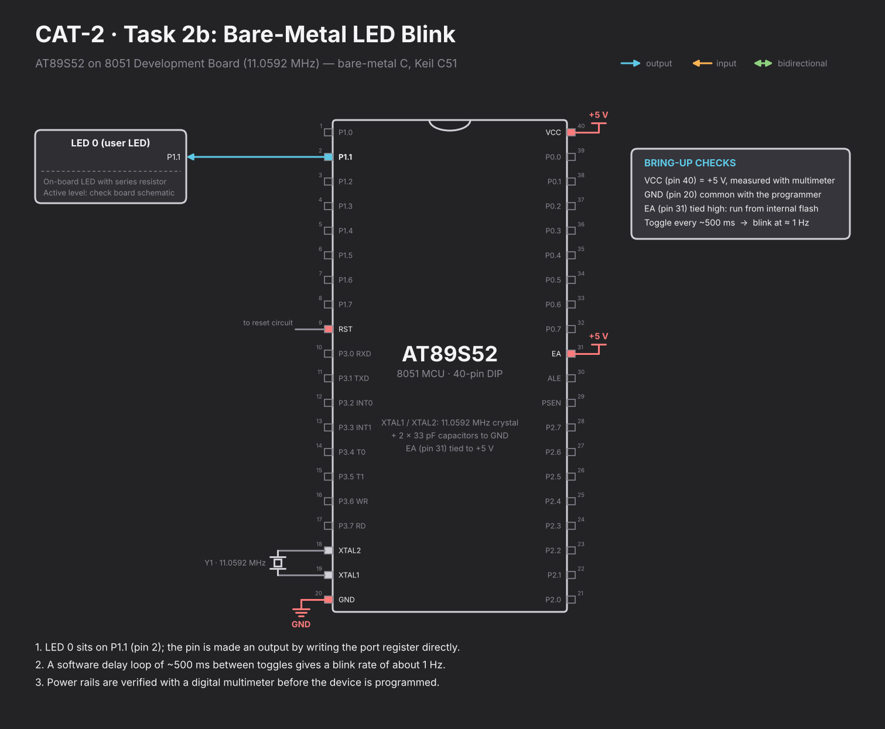

# Continuous Lab Evaluation-2

**EXP:** Continuous Lab Evaluation-2  
**DATE:** 20/07/2026  
**NAME OF EXP:** Bare-Metal GPIO Bring-Up and 1 Hz LED Blink Controller  
**HARDWARE SETUP / PLATFORM:** 8051 Tool Chain setup Development Board - AT89S52 + Keil C51 + Onboard LED + Multimeter  
**TASK NO:** 2b  

---

## Circuit Diagram



* **Onboard LED (`LED0`):** `P1.1` (Pin 2, active-low via 330 $\Omega$ series resistor)
* **Clock & Reset:** 11.0592 MHz crystal across `XTAL1` (Pin 19) & `XTAL2` (Pin 18); active-high reset on `RST` (Pin 9)
* **Power Rails:** `VCC` (Pin 40) = +5 V, `EA` (Pin 31) = +5 V, `GND` (Pin 20) = 0 V

---

## Core Logic

1. **Direct Bit-Addressable SFR Control (`P1^1`)**  
   Maps the user LED directly to SFR bit `0x91` (`P1.1`) and initializes Port 1 high so the active-low LED starts in a known OFF state.
   ```c
   sbit LED0 = P1^1;

   void gpio_init(void) {
       P1 = 0xFF;
   }
   ```

2. **Calibrated Software Delay Library (`delay_ms`)**  
   Generates deterministic millisecond delays calibrated to the 11.0592 MHz crystal machine cycle ($1.085\,\mu\text{s}$).
   ```c
   void delay_ms(unsigned int ms) {
       unsigned int i, j;
       for (i = 0; i < ms; i++)
           for (j = 0; j < 114; j++);
   }
   ```

3. **1 Hz Blink Superloop**  
   Complements `P1.1` every 500 ms to produce a steady 1 Hz blink rate ($500\text{ ms ON} + 500\text{ ms OFF}$).
   ```c
   void main(void) {
       gpio_init();
       while (1) {
           LED0 = ~LED0;
           delay_ms(500);
       }
   }
   ```

---

## Inference

A bare-metal 1 Hz LED blink controller was implemented on the AT89S52 using direct memory-mapped SFR access (`P1^1`) and a modular software delay routine in Keil C51. Supply rails (+5 V) and 500 ms logic transitions on `P1.1` were verified with a digital multimeter.
