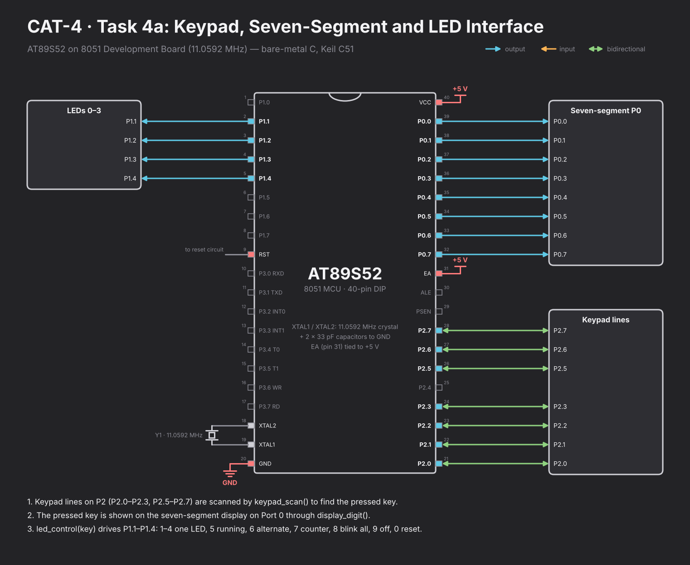

# Continuous Lab Evaluation-4

**EXP:** Continuous Lab Evaluation-4  
**DATE:** 10/08/2026  
**NAME OF EXP:** Human-Machine Interface (4×4 Matrix Keypad, 7-Segment Display & Status LEDs)  
**HARDWARE SETUP / PLATFORM:** 8051 Tool Chain setup Development Board - AT89S52 + Keil C51 + 4×4 Keypad + 7-Segment Display + 10 kΩ Pull-Up Network + Four LEDs  
**TASK NO:** 4a  

---

## Circuit Diagram



* **Four Mode LEDs (`LED1`–`LED4`):** `P1.0` – `P1.3` (Pins 1–4, active-low status indicators)
* **7-Segment Display (`a`–`g`, `dp`):** `P0.0` – `P0.7` (Pins 39–32, open-drain Port 0 with external 10 k$\Omega$ pull-ups)
* **4×4 Matrix Keypad:** Rows `R1`–`R4` on `P2.0`–`P2.3` (Pins 21–24); Columns `C1`–`C4` on `P2.4`–`P2.7` (Pins 25–28)

---

## Core Logic

1. **Sequential Row-Scan Keypad Decoder (`keypad_scan`)**  
   Pulls rows `P2.0`–`P2.3` low one at a time while reading columns `P2.4`–`P2.7`, decoding keys `0`–`9` after a 20 ms debounce delay.
   ```c
   unsigned char keypad_scan(void) {
       unsigned char r, c;
       for (r = 0; r < 4; r++) {
           P2 = 0xFF & ~(1 << r);
           if ((P2 & 0xF0) != 0xF0) {
               delay_ms(20);
               for (c = 0; c < 4; c++)
                   if (!(P2 & (0x10 << c))) { while ((P2 & 0xF0) != 0xF0); return (r * 4) + c; }
           }
       }
       return 0xFF;
   }
   ```

2. **Open-Drain Port 0 Seven-Segment Driver (`display_digit`)**  
   Writes the 7-segment bitmask for digits `0`–`9` directly to `P0` (`0x80`), using external 10 k$\Omega$ pull-up resistors to source high segments.
   ```c
   void display_digit(unsigned char digit) {
       const unsigned char seg[10] = {0x3F,0x06,0x5B,0x4F,0x66,0x6D,0x7D,0x07,0x7F,0x6F};
       if (digit <= 9) P0 = seg[digit];
   }
   ```

3. **Key-Dispatched LED Mode Controller (`led_control`)**  
   Maps keys `1`–`4` to individual LEDs, `5`–`8` to running, alternating, binary counter, and blink patterns, `9` to LEDs OFF, and `0` to system reset.
   ```c
   void led_control(unsigned char key) {
       if (key >= 1 && key <= 4) set_leds(1 << (key - 1));
       else if (key == 5) running_led();
       else if (key == 6) alternate_led();
       else if (key == 7) binary_counter();
       else if (key == 8) blink_all();
       else if (key == 9) set_leds(0x00);
       else if (key == 0) { display_digit(0); set_leds(0x00); }
   }
   ```

---

## Inference

A modular Human-Machine Interface was built on the AT89S52 by isolating keypad scanning on Port 2, 7-segment rendering on Port 0 with 10 k$\Omega$ pull-ups, and LED pattern control on Port 1. Pressing keys `0`–`9` updated the numeric display and executed the corresponding LED routine without port contention.
