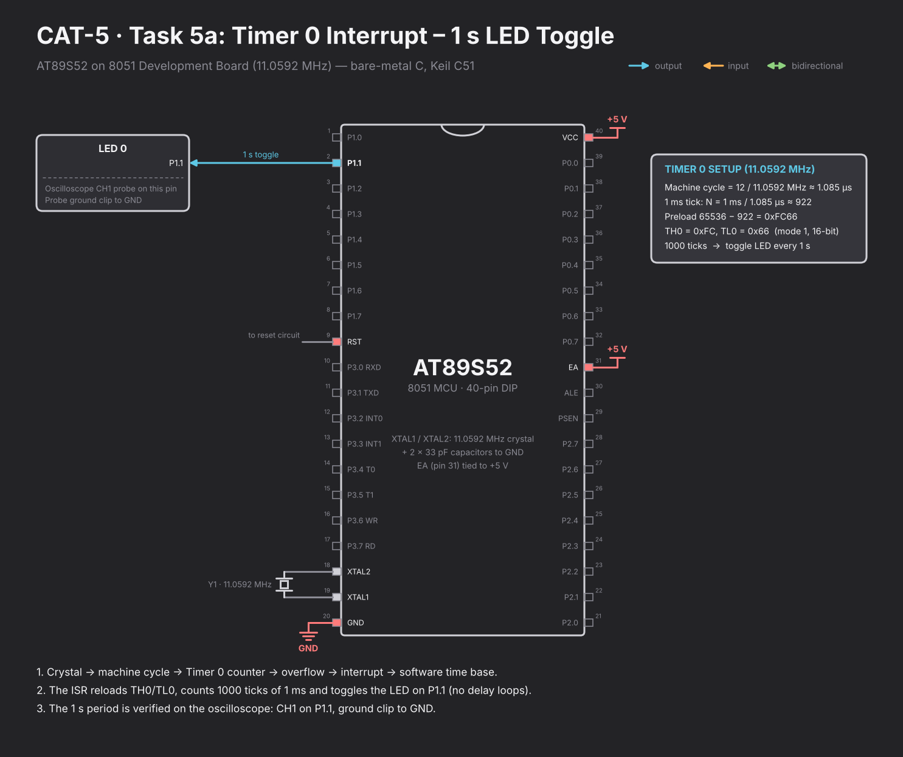

# Continuous Lab Evaluation-5

**EXP:** Continuous Lab Evaluation-5  
**DATE:** 24/08/2026  
**NAME OF EXP:** Hardware Timer 0 Interrupt – 1 Second Periodic LED Toggle  
**HARDWARE SETUP / PLATFORM:** 8051 Tool Chain setup Development Board - AT89S52 + Keil C51 + Onboard LED + Oscilloscope (DSO)  
**TASK NO:** 5a  

---

## Circuit Diagram



* **LED & DSO Probe (`CH1`):** `P1.1` (Pin 2, toggles once every 1000 ms)
* **System Clock:** 11.0592 MHz crystal across `XTAL1` (Pin 19) & `XTAL2` (Pin 18) ($T_{\text{machine}} = 1.085\,\mu\text{s}$)
* **Ground Reference:** `GND` (Pin 20) connected to DSO ground clip

---

## Core Logic

1. **Timer 0 Mode 1 Configuration (`0xFC66` Preload for 1 ms)**  
   Sets Timer 0 to 16-bit Mode 1 (`TMOD = 0x01`) with preload `65536 - 922 = 64614` (`0xFC66`) for a 1.000 ms overflow period at 11.0592 MHz, enabling `EA` and `ET0` (`IE = 0x82`).
   ```c
   void timer0_init(void) {
       TMOD = (TMOD & 0xF0) | 0x01;
       TH0 = 0xFC; TL0 = 0x66;
       IE = 0x82;
       TR0 = 1;
   }
   ```

2. **Non-Blocking 1 ms ISR & 1 Second Toggle**  
   Reloads `TH0:TL0` inside Interrupt Vector `0x000B` (`interrupt 1`) and toggles `P1.1` after 1000 ticks without blocking `main()`.
   ```c
   void timer0_isr(void) interrupt 1 {
       TH0 = 0xFC; TL0 = 0x66;
       if (++ms_ticks >= 1000) {
           ms_ticks = 0;
           LED0 = ~LED0;
       }
   }
   ```

---

## Inference

Hardware Timer 0 was configured in 16-bit Mode 1 with a `0xFC66` preload to generate a 1 ms periodic interrupt at 11.0592 MHz, eliminating blocking delay loops. Oscilloscope measurements on `P1.1` confirmed accurate 1.00 s high and 1.00 s low pulse widths.
