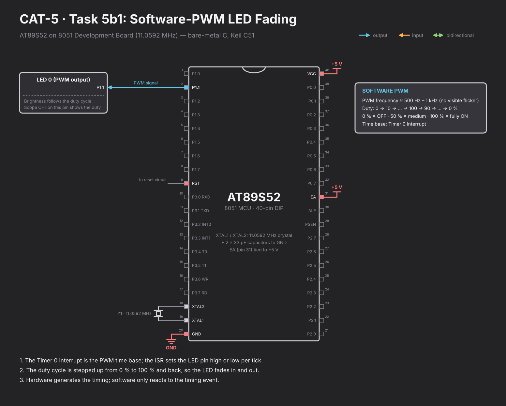

# Continuous Lab Evaluation-5

**EXP:** Continuous Lab Evaluation-5  
**DATE:** 24/08/2026  
**NAME OF EXP:** Timer 0 Interrupt-Driven Software PWM LED Fading  
**HARDWARE SETUP / PLATFORM:** 8051 Tool Chain setup Development Board - AT89S52 + Keil C51 + Onboard LED + Oscilloscope (DSO)  
**TASK NO:** 5b1  

---

## Circuit Diagram



* **PWM LED & DSO Probe (`CH1`):** `P1.1` (Pin 2, 1 kHz PWM carrier with 0%–100%–0% duty sweep)
* **System Clock & Ground:** 11.0592 MHz crystal (`XTAL1`/`XTAL2` Pins 19, 18), common DSO ground on `GND` (Pin 20)

---

## Core Logic

1. **20 $\mu$s Timer 0 Time-Slice Setup (`0xFFEE` Reload)**  
   Configures Timer 0 to overflow every $20\,\mu\text{s}$ ($N = 18$ machine cycles), dividing each $1\text{ ms}$ ($1\text{ kHz}$) PWM period into 50 discrete duty steps.
   ```c
   void timer0_pwm_init(void) {
       TMOD = (TMOD & 0xF0) | 0x01;
       TH0 = 0xFF; TL0 = 0xEE;
       IE = 0x82;
       TR0 = 1;
   }
   ```

2. **ISR Duty-Cycle Comparator & Brightness Ramp**  
   Compares `pwm_tick` (`0..49`) against `duty_steps` inside `interrupt 1` to modulate `P1.1` while smoothly sweeping brightness from 0% to 100% and back to 0%.
   ```c
   void timer0_isr(void) interrupt 1 {
       TH0 = 0xFF; TL0 = 0xEE;
       pwm_tick = (pwm_tick + 1) % 50;
       LED0 = (pwm_tick < duty_steps) ? 0 : 1;
   }
   ```

---

## Inference

A flicker-free 1 kHz software PWM signal was synthesized on `P1.1` using a 20 $\mu$s Timer 0 time-slice interrupt on the AT89S52. Sweeping `duty_steps` across 0%–100%–0% produced smooth LED fading and continuous duty-cycle modulation on the oscilloscope.
