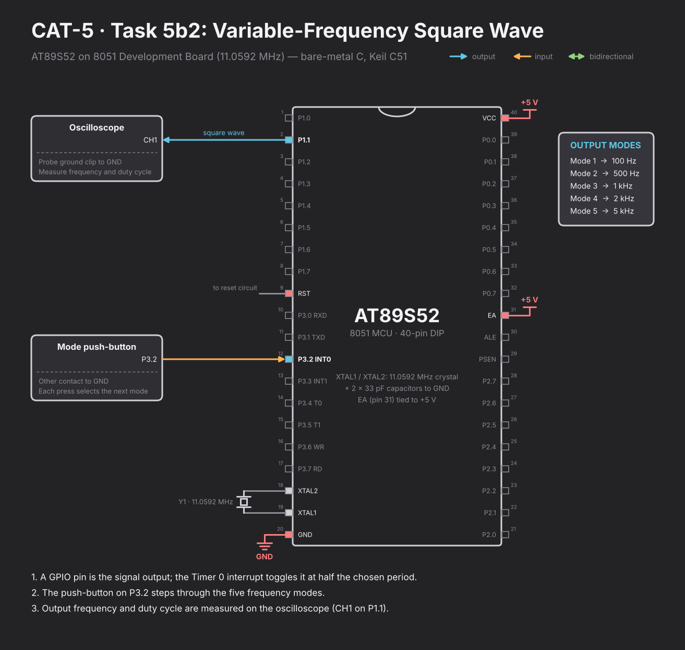

# Continuous Lab Evaluation-5

**EXP:** Continuous Lab Evaluation-5  
**DATE:** 24/08/2026  
**NAME OF EXP:** Timer 0 Variable-Frequency Square-Wave Generator (100 Hz – 5 kHz)  
**HARDWARE SETUP / PLATFORM:** 8051 Tool Chain setup Development Board - AT89S52 + Keil C51 + Push-button + Oscilloscope (DSO)  
**TASK NO:** 5b2  

---

## Circuit Diagram



* **Square-Wave Output (`CH1`):** `P1.2` (Pin 3, 50% duty cycle at 100 Hz, 500 Hz, 1 kHz, 2 kHz, or 5 kHz)
* **Frequency Select Switch (`SW1`):** `P3.2 / INT0` (Pin 12, active-low debounced input)
* **Ground Reference:** `GND` (Pin 20) connected to DSO ground clip

---

## Core Logic

1. **Half-Period 16-Bit Reload Lookup Table (11.0592 MHz)**  
   Stores precomputed `TH0:TL0` reload values (`65536 - N`, where $N = \frac{1}{2f \cdot 1.085\,\mu\text{s}}$) for 100 Hz (`0xEE00`), 500 Hz (`0xFC66`), 1 kHz (`0xFE33`), 2 kHz (`0xFF1A`), and 5 kHz (`0xFFA4`).
   ```c
   const unsigned char th_tab[5] = {0xEE, 0xFC, 0xFE, 0xFF, 0xFF};
   const unsigned char tl_tab[5] = {0x00, 0x66, 0x33, 0x1A, 0xA4};
   volatile unsigned char mode_idx = 0;
   ```

2. **ISR Half-Period Output Toggle**  
   Reloads the active mode's `TH0:TL0` pair and complements `P1.2` every half-period $T/2$ inside `interrupt 1`.
   ```c
   void timer0_isr(void) interrupt 1 {
       TH0 = th_tab[mode_idx];
       TL0 = tl_tab[mode_idx];
       WAVE_OUT = ~WAVE_OUT;
   }
   ```

---

## Inference

A five-mode square-wave generator covering 100 Hz to 5 kHz was implemented on `P1.2` using precomputed Timer 0 half-period reloads. DSO measurements verified a 50.0% duty cycle and accurate output frequencies across all five selectable modes.
