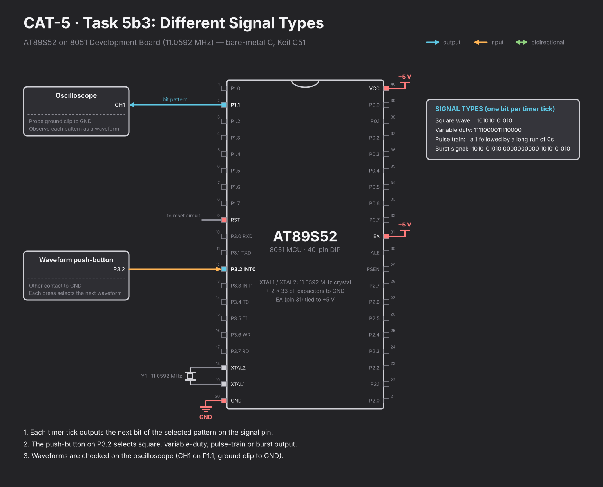

# Continuous Lab Evaluation-5

**EXP:** Continuous Lab Evaluation-5  
**DATE:** 24/08/2026  
**NAME OF EXP:** Timer-Driven Multi-Waveform Digital Bitstream Generator  
**HARDWARE SETUP / PLATFORM:** 8051 Tool Chain setup Development Board - AT89S52 + Keil C51 + Push-button + Oscilloscope (DSO)  
**TASK NO:** 5b3  

---

## Circuit Diagram



* **Waveform Output (`CH1`):** `P1.2` (Pin 3, serial digital bitstream output)
* **Waveform Select Switch (`SW1`):** `P3.2 / INT0` (Pin 12, cycles Square, Variable Duty, Pulse Train, and Burst)
* **Ground Reference:** `GND` (Pin 20) connected to DSO ground clip

---

## Core Logic

1. **Digital Waveform Bitstream Lookup Arrays**  
   Encodes four digital pulse shapes—50% Square Wave, Low-Frequency Variable Duty Wave, 12.5% Narrow Pulse Train, and a 5-Pulse Gated Burst—as bit arrays.
   ```c
   const unsigned char sq[8]    = {1,0,1,0,1,0,1,0};
   const unsigned char duty[8]  = {1,1,1,1,0,0,0,0};
   const unsigned char pulse[8] = {1,0,0,0,0,0,0,0};
   const unsigned char burst[20]= {1,0,1,0,1,0,1,0,1,0, 0,0,0,0,0,0,0,0,0,0};
   ```

2. **Timer 0 Bit-Clock Serializer (`interrupt 1`)**  
   Shifts one bit per Timer 0 overflow tick onto `P1.2` and wraps the index modulo the active pattern length.
   ```c
   void timer0_isr(void) interrupt 1 {
       TH0 = 0xFE; TL0 = 0x33;
       WAVE_OUT = active_pat[bit_idx];
       bit_idx = (bit_idx + 1) % active_len;
   }
   ```

---

## Inference

Four distinct digital waveforms (square, variable duty-cycle, pulse train, and gated burst) were synthesized on `P1.2` using a periodic Timer 0 bit-clock ISR and lookup tables. Triggered DSO captures verified clean transitions and exact duty ratios without external signal-generator hardware.
