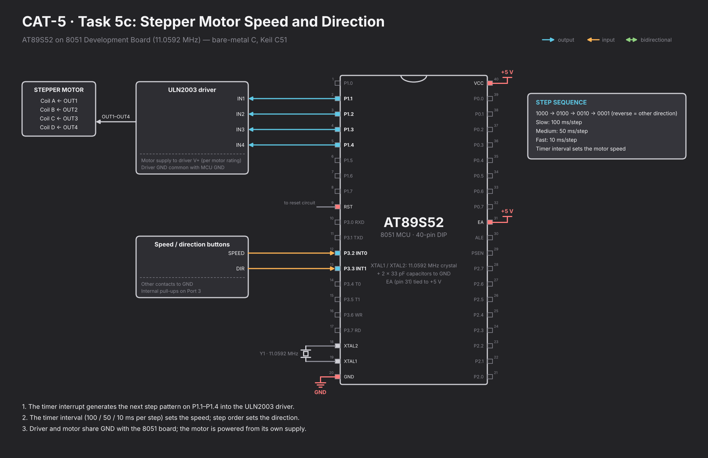

# Continuous Lab Evaluation-5

**EXP:** Continuous Lab Evaluation-5  
**DATE:** 24/08/2026  
**NAME OF EXP:** Timer-Driven Unipolar Stepper Motor Speed and Direction Controller  
**HARDWARE SETUP / PLATFORM:** 8051 Tool Chain setup Development Board - AT89S52 + Keil C51 + ULN2003 Driver + Unipolar Stepper Motor + Two Push-buttons  
**TASK NO:** 5c  

---

## Circuit Diagram



* **Motor Phase Outputs:** `P1.0` – `P1.3` (Pins 1–4) $\rightarrow$ ULN2003 `IN1`–`IN4` $\rightarrow$ Stepper Coils `A`–`D`
* **Speed & Direction Inputs:** `SW1` (Speed: 100/50/10 ms) on `P3.2 / INT0` (Pin 12); `SW2` (CW/CCW) on `P3.3 / INT1` (Pin 13)
* **Power & Ground:** Separate motor supply through ULN2003 sharing common `GND` (Pin 20)

---

## Core Logic

1. **Wave-Drive Excitation Table (`P1[3:0]`)**  
   Defines single-coil phase masks (`0x08`, `0x04`, `0x02`, `0x01`) for driving the ULN2003 inputs cleanly without disturbing upper Port 1 pins.
   ```c
   const unsigned char phase_lut[4] = {0x08, 0x04, 0x02, 0x01};
   volatile unsigned char step_idx = 0, dir_ccw = 0;
   volatile unsigned int step_ms = 100, tick_ms = 0;
   ```

2. **Non-Blocking Timer 0 Step Scheduler**  
   Counts 1 ms Timer 0 interrupts (`0xFC66` reload) and advances or reverses `step_idx` modulo 4 whenever `tick_ms` reaches the selected speed preset (`100`, `50`, or `10` ms).
   ```c
   void timer0_isr(void) interrupt 1 {
       TH0 = 0xFC; TL0 = 0x66;
       if (++tick_ms >= step_ms) {
           tick_ms = 0;
           step_idx = dir_ccw ? ((step_idx + 3) & 3) : ((step_idx + 1) & 3);
           P1 = (P1 & 0xF0) | phase_lut[step_idx];
       }
   }
   ```

---

## Inference

Non-blocking speed and direction control of a 4-phase unipolar stepper motor was achieved by buffering `P1.0`–`P1.3` through a ULN2003 driver under Timer 0 millisecond scheduling. Speed transitions across 100 ms, 50 ms, and 10 ms presets and CW/CCW reversals executed smoothly without blocking switch polling.
