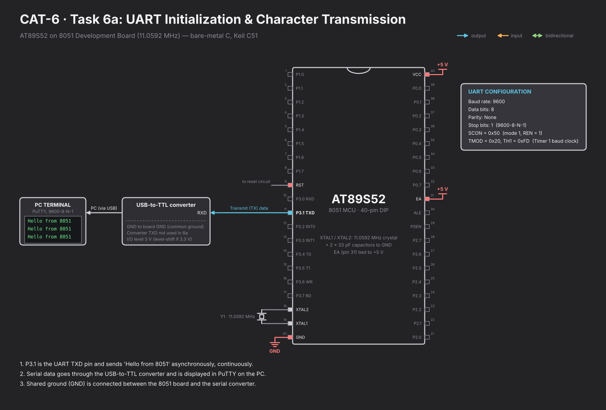

# Continuous Lab Evaluation-6

**EXP:** Continuous Lab Evaluation-6  
**DATE:** 14/09/2026  
**NAME OF EXP:** Hardware UART Initialization (9600-8-N-1) and Continuous Serial Transmission  
**HARDWARE SETUP / PLATFORM:** 8051 Tool Chain setup Development Board - AT89S52 + Keil C51 + USB-to-TTL Adapter + PC (PuTTY)  
**TASK NO:** 6a  

---

## Circuit Diagram



* **UART Transmit (`TXD`):** `P3.1` (Pin 11) $\rightarrow$ USB-to-TTL Adapter `RX` (9600-8-N-1)
* **Baud Clock Source:** 11.0592 MHz crystal across `XTAL1` (Pin 19) & `XTAL2` (Pin 18)
* **Ground Reference:** `GND` (Pin 20) $\rightarrow$ USB-to-TTL Adapter `GND`

---

## Core Logic

1. **UART Mode 1 & Timer 1 Auto-Reload Setup (`TH1 = 0xFD`)**  
   Configures `SCON = 0x50` (8-bit UART) and Timer 1 Mode 2 (`0x20`) with `TH1 = 0xFD` ($256 - \frac{11.0592\text{ MHz}}{32 \times 12 \times 9600} = 253$) for exact 9600 bps communication.
   ```c
   void uart_init(void) {
       SCON = 0x50;
       TMOD = (TMOD & 0x0F) | 0x20;
       TH1 = 0xFD; TL1 = 0xFD;
       TR1 = 1;
   }
   ```

2. **Polling Byte & String Transmission (`SBUF` / `TI`)**  
   Writes each character into `SBUF`, polls `TI` until stop-bit completion, and clears `TI` in software while streaming `"Hello from 8051\r\n"`.
   ```c
   void uart_tx_string(const char *s) {
       while (*s) {
           SBUF = *s++;
           while (!TI);
           TI = 0;
       }
   }
   ```

---

## Inference

Hardware UART transmission at 9600-8-N-1 was established on the AT89S52 using Timer 1 Mode 2 auto-reload (`TH1 = 0xFD`) clocked at 11.0592 MHz. Continuous transmission of `"Hello from 8051\r\n"` over `P3.1` displayed cleanly in PuTTY with zero baud-rate drift.
