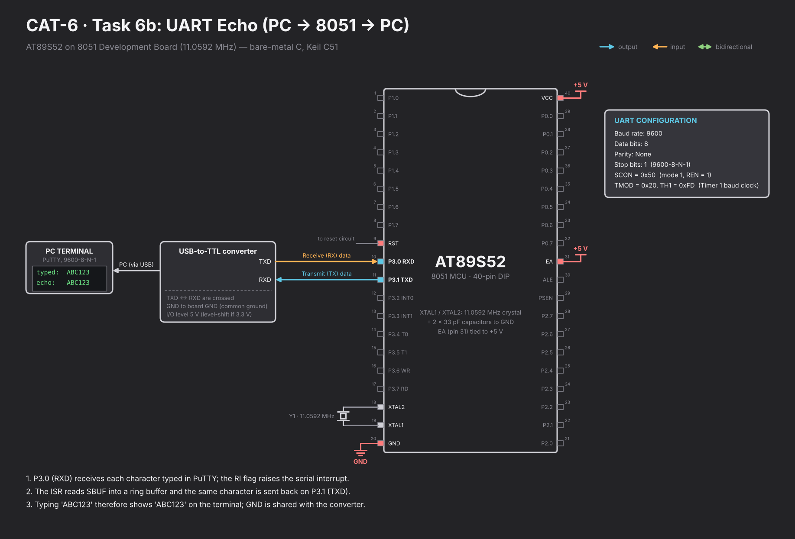

# Continuous Lab Evaluation-6

**EXP:** Continuous Lab Evaluation-6  
**DATE:** 14/09/2026  
**NAME OF EXP:** Full-Duplex Interrupt-Driven UART Echo with Circular RX Ring Buffer  
**HARDWARE SETUP / PLATFORM:** 8051 Tool Chain setup Development Board - AT89S52 + Keil C51 + USB-to-TTL Adapter + PC (PuTTY)  
**TASK NO:** 6b  

---

## Circuit Diagram



* **UART Receive (`RXD`):** `P3.0` (Pin 10) $\leftarrow$ USB-to-TTL Adapter `TX` (`PC → 8051`)
* **UART Transmit (`TXD`):** `P3.1` (Pin 11) $\rightarrow$ USB-to-TTL Adapter `RX` (`8051 → PC`)
* **Ground Reference:** `GND` (Pin 20) $\rightarrow$ USB-to-TTL Adapter `GND`

---

## Core Logic

1. **Interrupt-Enabled UART & 32-Byte RX Ring Buffer**  
   Enables Serial Port Interrupt (`ES = 1`) and Global Interrupts (`EA = 1`) via `IE = 0x90` alongside a circular FIFO buffer (`rx_buf`) to capture incoming characters asynchronously.
   ```c
   #define BUF_SZ 32
   volatile char rx_buf[BUF_SZ];
   volatile unsigned char head = 0, tail = 0;

   void uart_irq_init(void) {
       SCON = 0x50; TMOD = (TMOD & 0x0F) | 0x20;
       TH1 = 0xFD; TL1 = 0xFD;
       IE = 0x90; TR1 = 1;
   }
   ```

2. **Serial ISR (`interrupt 4`) & Main-Loop Echo Task**  
   Pushes received `SBUF` bytes into `rx_buf` when `RI == 1` inside Vector `0x0023` and echoes buffered characters back to PuTTY in FIFO order.
   ```c
   void uart_isr(void) interrupt 4 {
       if (RI) {
           RI = 0;
           rx_buf[head] = SBUF;
           head = (head + 1) & (BUF_SZ - 1);
       }
   }
   ```

---

## Inference

A full-duplex, interrupt-driven UART driver with a 32-byte circular RX ring buffer was implemented on the AT89S52 using Serial Interrupt Vector `0x0023`. Testing in PuTTY (with local echo disabled) confirmed real-time, loss-free character echoing (`ABC123`, `Hello 8051`).
