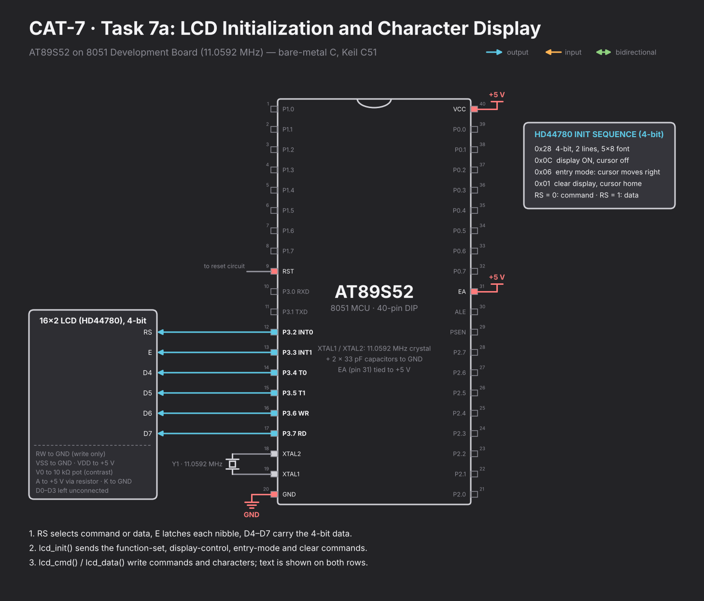

# Continuous Lab Evaluation-7

**EXP:** Continuous Lab Evaluation-7  
**DATE:** 05/10/2026  
**NAME OF EXP:** 16×2 HD44780 Character LCD Driver in 4-Bit Bus Mode  
**HARDWARE SETUP / PLATFORM:** 8051 Tool Chain setup Development Board - AT89S52 + Keil C51 + 16×2 LCD (HD44780) + 10 kΩ Contrast Potentiometer  
**TASK NO:** 7a  

---

## Circuit Diagram



* **Control Lines:** `RS` $\rightarrow$ `P2.0` (Pin 21), `EN` $\rightarrow$ `P2.1` (Pin 22), `RW` tied to `GND` (write-only)
* **4-Bit Data Bus:** `D4`–`D7` (LCD Pins 11–14) $\rightarrow$ `P2.4`–`P2.7` (Pins 25–28)
* **Power & Contrast:** `VDD`/`A` = +5 V, `VSS`/`K` = `GND`, `VO` = 10 k$\Omega$ potentiometer wiper

---

## Core Logic

1. **4-Bit Nibble Multiplexing & Enable Strobe**  
   Splits each 8-bit instruction or ASCII byte into upper and lower nibbles on `P2[7:4]`, latching each nibble on the high-to-low transition of `EN` (`P2.1`).
   ```c
   sbit LCD_RS = P2^0;
   sbit LCD_EN = P2^1;

   void lcd_nibble(unsigned char nib) {
       P2 = (P2 & 0x0F) | (nib & 0xF0);
       LCD_EN = 1; delay_ms(1); LCD_EN = 0;
   }
   ```

2. **HD44780 4-Bit Datasheet Initialization**  
   Sends the 4-bit initialization sequence (`0x02`, `0x28`, `0x0C`, `0x06`, `0x01`) to configure a 2-line, 5×8 font display before writing characters to Row 1 (`0x80`) and Row 2 (`0xC0`).
   ```c
   void lcd_init(void) {
       delay_ms(20);
       lcd_cmd(0x02); lcd_cmd(0x28);
       lcd_cmd(0x0C); lcd_cmd(0x06); lcd_cmd(0x01);
   }
   ```

---

## Inference

A bare-metal 4-bit HD44780 LCD driver was implemented on Port 2 of the AT89S52 using six GPIO lines (`RS`, `EN`, and `D4`–`D7`). Following the datasheet nibble initialization sequence produced crisp character and string rendering across both rows of the 16×2 LCD.
