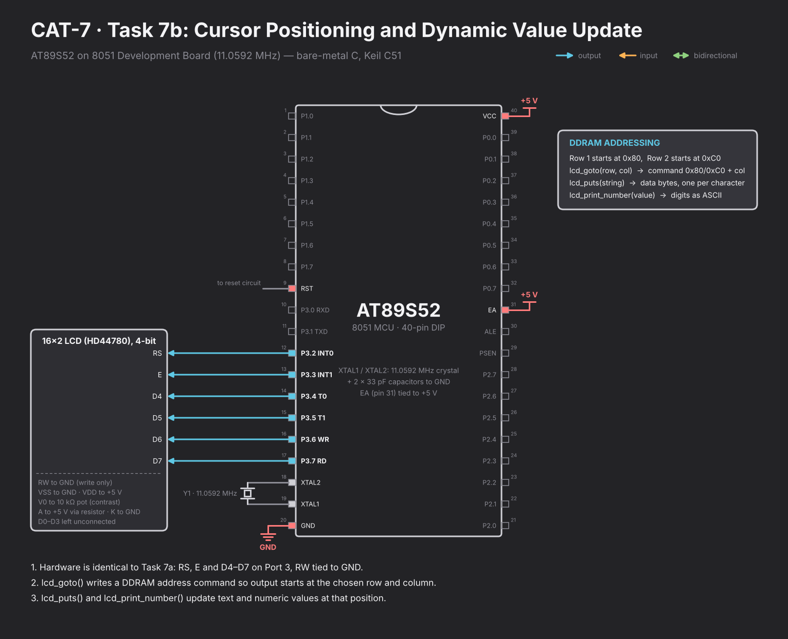

# Continuous Lab Evaluation-7

**EXP:** Continuous Lab Evaluation-7  
**DATE:** 05/10/2026  
**NAME OF EXP:** LCD Random-Access Cursor Positioning and Flicker-Free Numeric Updates  
**HARDWARE SETUP / PLATFORM:** 8051 Tool Chain setup Development Board - AT89S52 + Keil C51 + 16×2 LCD (HD44780) + Push-button  
**TASK NO:** 7b  

---

## Circuit Diagram



* **16×2 LCD Bus (Port 2):** `RS` (`P2.0`, Pin 21), `EN` (`P2.1`, Pin 22), `D4`–`D7` (`P2.4`–`P2.7`, Pins 25–28), `RW` = `GND`
* **Counter Trigger (`SW1`):** `P3.2 / INT0` (Pin 12, increments live numeric counter)

---

## Core Logic

1. **DDRAM Cursor Positioning (`lcd_goto`)**  
   Computes exact HD44780 DDRAM addresses (`0x80 + col` for Row 0, `0xC0 + col` for Row 1) to place the cursor directly at any `(row, col)` cell.
   ```c
   void lcd_goto(unsigned char row, unsigned char col) {
       lcd_cmd((row == 0 ? 0x80 : 0xC0) + col);
   }
   ```

2. **In-Place Fixed-Width Numeric Rendering (`lcd_print_number`)**  
   Formats unsigned integers into ASCII digits at fixed `(row, col)` coordinates without issuing full-screen `0x01` clears, eliminating visual flicker.
   ```c
   void lcd_print_number(unsigned char row, unsigned char col, unsigned int val) {
       lcd_goto(row, col);
       lcd_data('0' + ((val / 1000) % 10));
       lcd_data('0' + ((val / 100)  % 10));
       lcd_data('0' + ((val / 10)   % 10));
       lcd_data('0' + (val % 10));
   }
   ```

---

## Inference

Random-access DDRAM cursor addressing (`lcd_goto`) and fixed-width integer formatting were added to the 4-bit HD44780 driver on the AT89S52. Updating numeric values in place eliminated clear-display delays and produced completely flicker-free live telemetry updates.
