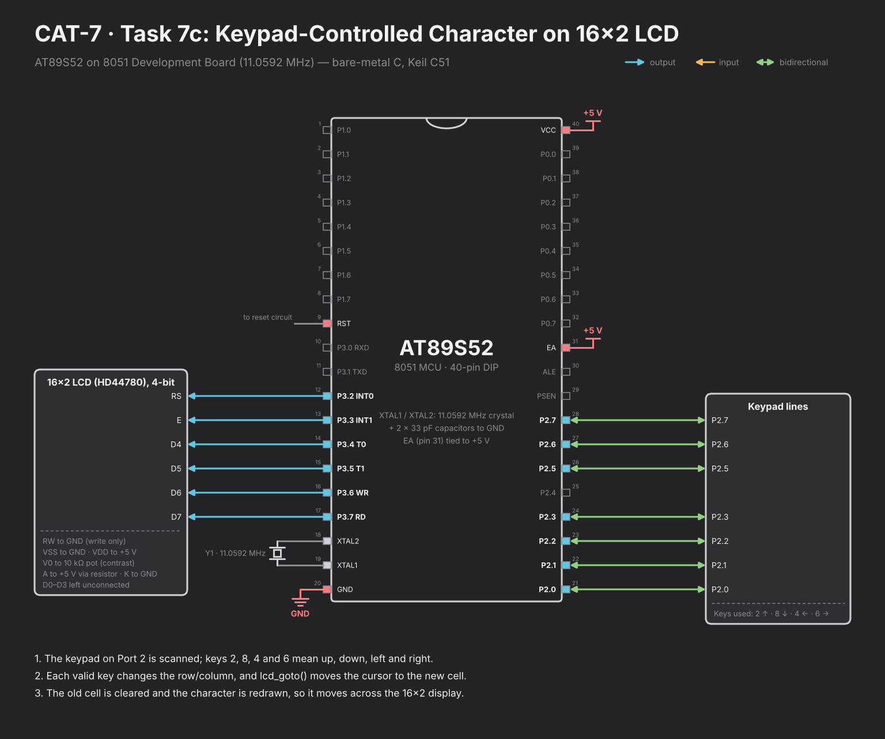

# Continuous Lab Evaluation-7

**EXP:** Continuous Lab Evaluation-7  
**DATE:** 05/10/2026  
**NAME OF EXP:** 4×4 Matrix Keypad-Controlled Character Navigation on 16×2 LCD  
**HARDWARE SETUP / PLATFORM:** 8051 Tool Chain setup Development Board - AT89S52 + Keil C51 + 4×4 Matrix Keypad + 16×2 LCD (HD44780)  
**TASK NO:** 7c  

---

## Circuit Diagram



* **4×4 Keypad (Port 1):** Rows `R1`–`R4` on `P1.0`–`P1.3` (Pins 1–4); Columns `C1`–`C4` on `P1.4`–`P1.7` (Pins 5–8)
* **16×2 LCD (Port 2):** `RS` (`P2.0`, Pin 21), `EN` (`P2.1`, Pin 22), `D4`–`D7` (`P2.4`–`P2.7`, Pins 25–28), `RW` = `GND`

---

## Core Logic

1. **Port-Isolated Directional Key Scanner**  
   Scans the 4×4 keypad on Port 1 while keeping the 4-bit LCD bus isolated on Port 2, filtering keys `'2'` (Up), `'8'` (Down), `'4'` (Left), and `'6'` (Right).
   ```c
   unsigned char get_dir_key(void) {
       unsigned char k = keypad_scan_p1();
       return (k == '2' || k == '8' || k == '4' || k == '6') ? k : 0;
   }
   ```

2. **Erase-Before-Draw 2D Grid Navigation**  
   Clears the previous cell with `' '`, updates `(row, col)` within the $2\times16$ LCD bounds, and draws the active character at the new coordinate.
   ```c
   void move_sprite(unsigned char k) {
       lcd_goto(row, col); lcd_data(' ');
       if (k == '2') row = 0;
       else if (k == '8') row = 1;
       else if (k == '4') col = (col > 0) ? (col - 1) : 15;
       else if (k == '6') col = (col < 15) ? (col + 1) : 0;
       lcd_goto(row, col); lcd_data('*');
   }
   ```

---

## Inference

An interactive 2D character navigation controller was built on the AT89S52 by isolating the 4×4 keypad on Port 1 and the 4-bit HD44780 LCD on Port 2. Debounced directional keypresses (`2`, `8`, `4`, `6`) moved the sprite cleanly across all 32 display cells with erase-before-draw updates preventing ghost trails.
