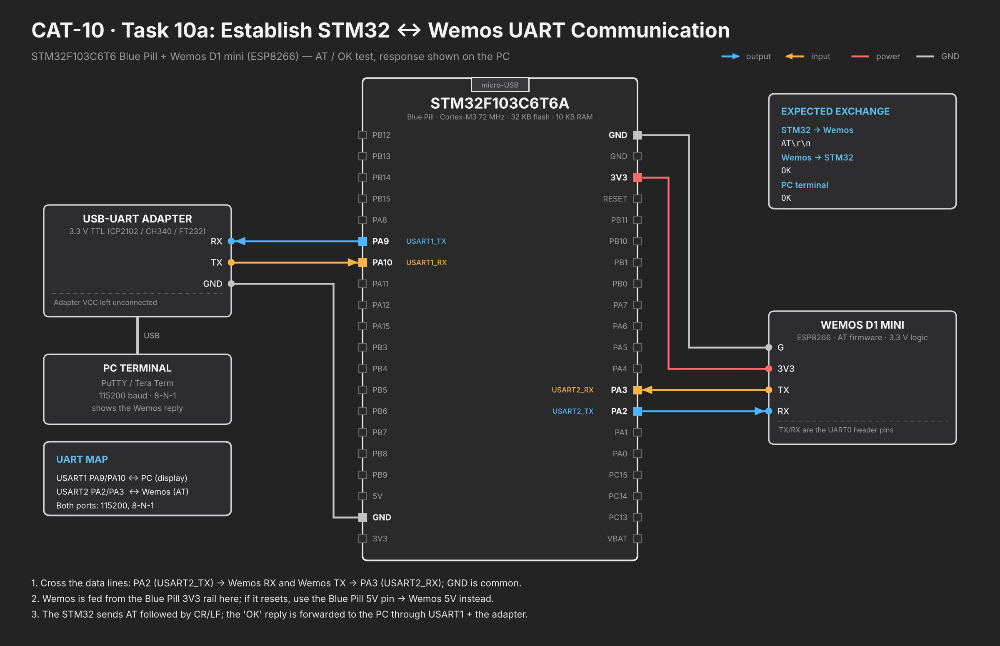

# EXPERIMENT DETAILS
**EXP:** CONTINUOUS ASSESSMENT 10
**DATE:** 05/10/2026
**NAME OF EXP:** STM32-Wemos Wi-Fi Modem Interface Using AT Commands
**HARDWARE SETUP / PLATFORM:** CubeMX + Keil MDK + STM32 development board (STM32F103C8T6)
---
## TASK 10A Establish STM32-Wemos UART Communication
### 1. Circuit Diagram
- STM32 development board configured as STM32F103C8T6.
- USART2: PA2 (TX) and PA3 (RX).
- Wemos D1 Mini / ESP8266 UART: Wemos RX receives PA2; Wemos TX would connect to PA3 for receive capability, although the supplied application does not read it.
- Common GND between STM32 and Wemos.
- Wemos power input: suitable regulated supply (voltage/current rating not specified in the problem statement).

### 2. Core Logic / Pseudocode / Code Base
**Working Principle:** USART2 is initialized at 115200 baud. The application transmits AT, AT+CWMODE=1, AT+CWDHCP=1,1, AT+CWJAP and AT+CIFSR with fixed delays. USART1 is initialized but not used by the application.
**Pseudocode:**
1. Initialize HAL and configure the system clock.
2. Initialize GPIO, USART1 and USART2.
3. Transmit the AT command sequence through huart2.
4. Wait between commands using HAL_Delay.
5. Remain in the infinite loop.
**Code Base:** HAL_UART_Transmit, HAL_Delay, USART1 and USART2 initialization; huart2.
### 3. Inference
This task demonstrates UART-based interfacing between an STM32 and an ESP8266 Wi-Fi modem. The observed serial behaviour depends on the selected UART connections, modem firmware response and configured access point. The problem statement assigns USART1 to STM32-Wemos and USART2 to STM32-PC. This source sends commands through USART2, does not receive the modem response, and does not forward data to a PC terminal. Preserve the source, but note this mismatch.
