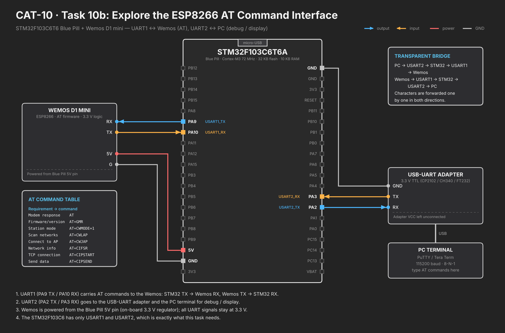

# EXPERIMENT DETAILS
**EXP:** CONTINUOUS ASSESSMENT 10
**DATE:** 05/10/2026
**NAME OF EXP:** STM32-Wemos Wi-Fi Modem Interface Using AT Commands
**HARDWARE SETUP / PLATFORM:** CubeMX + Keil MDK + STM32 development board (STM32F103C8T6)
---
## TASK 10B Explore the ESP8266 AT Command Interface
### 1. Circuit Diagram
- STM32 development board configured as STM32F103C8T6.
- USART1: PA9 (TX) and PA10 (RX) connected to ESP8266 RX and TX respectively.
- USART2: PA2 (TX) and PA3 (RX) connected to USB-UART adapter RX and TX respectively for the PC terminal.
- Common GND between STM32, ESP8266 and USB-UART adapter.
- ESP8266 power: regulated 3.3 V supply capable of the module current; exact supply model is not specified.

### 2. Core Logic / Pseudocode / Code Base
**Working Principle:** The firmware implements a transparent serial bridge. Characters typed in the PC terminal are forwarded to the ESP8266, and response characters from the ESP8266 are forwarded back to the terminal. Students can use this bridge to investigate the AT commands listed in the problem statement.
**Pseudocode:**
1. Initialize HAL, clock, GPIO, USART1 and USART2.
2. Print a short instruction through USART2.
3. Read one character from USART2 and forward it through USART1.
4. Read one character from USART1 and forward it through USART2.
5. Repeat continuously.
**Code Base:** HAL_UART_Receive, HAL_UART_Transmit, USART1 and USART2; pc_character and esp_character.
### 3. Inference
This task demonstrates UART-based interfacing between an STM32 and an ESP8266 Wi-Fi modem. The observed serial behaviour depends on the selected UART connections, modem firmware response and configured access point. This generated transparent bridge supports the command investigation requested in 10B. UART1 is assigned to the ESP8266 and UART2 to the PC terminal.
