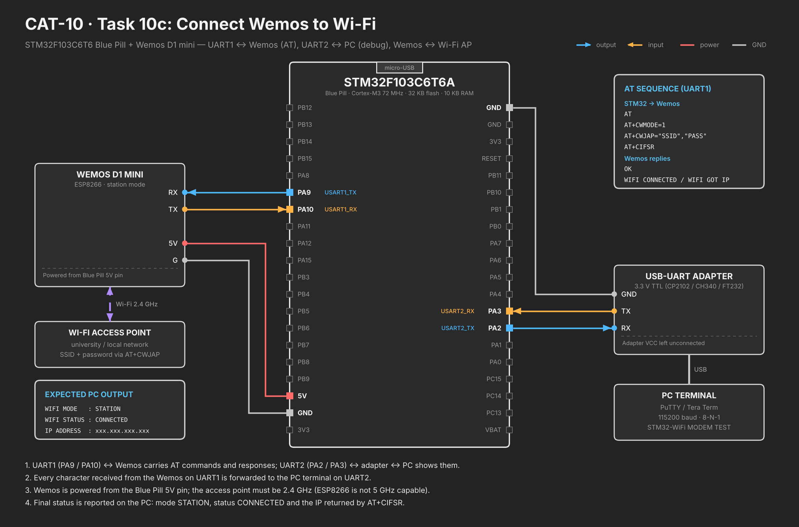

# EXPERIMENT DETAILS
**EXP:** CONTINUOUS ASSESSMENT 10
**DATE:** 05/10/2026
**NAME OF EXP:** STM32-Wemos Wi-Fi Modem Interface Using AT Commands
**HARDWARE SETUP / PLATFORM:** CubeMX + Keil MDK + STM32 development board (STM32F410RBT6, as specified by CAT10C.ioc)
---
## TASK 10C Connect Wemos to Wi-Fi
### 1. Circuit Diagram
- STM32 development board configured for STM32F410RBT6 as specified by CAT10C.ioc.
- USART1: PA9 (TX) and PA10 (RX) connected to ESP8266 RX and TX respectively.
- USART6: PC6 (TX) and PC7 (RX) connected to a USB-UART adapter for PC debug output.
- USART2: PA2 and PA3 are initialized by the code but not used by the application.
- Common GND between STM32, ESP8266 and debug adapter.
- ESP8266 power: regulated 3.3 V supply capable of the module current; exact supply model is not specified.

### 2. Core Logic / Pseudocode / Code Base
**Working Principle:** The supplied firmware configures the ESP8266 as a station, joins the hardcoded Wi-Fi access point, queries the IP address, enables multiple TCP connections and starts an HTTP server on port 80. It forwards modem/debug text through USART6.
**Pseudocode:**
1. Initialize HAL, clock, GPIO, USART1, USART2 and USART6.
2. Send AT and configure station mode.
3. Join the configured access point and query the IP address.
4. Enable multiple connections and start the TCP server.
5. Wait for +IPD requests, transmit an HTTP response and close the client connection.
**Code Base:** HAL_UART_Transmit, HAL_UART_Receive, HAL_GetTick, snprintf, strstr and atoi; USART1, USART2, USART6; rx_buffer, http_response and at_command.
### 3. Inference
This task demonstrates UART-based interfacing between an STM32 and an ESP8266 Wi-Fi modem. The observed serial behaviour depends on the selected UART connections, modem firmware response and configured access point. The source implements an HTTP server in addition to the stated Wi-Fi station connection. It hardcodes SSID SNUC and password snu12345. USART2 is initialized but unused. CAT10C.ioc targets STM32F410RBT6, not an STM32F103 Blue Pill. Its HSE bypass clock configuration requires a suitable external clock source.
