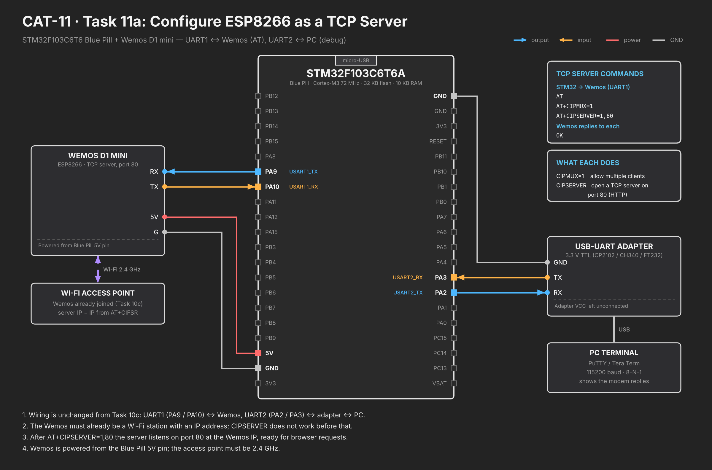

# EXPERIMENT DETAILS
**EXP:** CONTINUOUS ASSESSMENT 11
**DATE:** 12/10/2026
**NAME OF EXP:** HTTP Server - STM32-Wemos Wi-Fi Modem Using AT Commands
**HARDWARE SETUP / PLATFORM:** STM32CubeMX + Keil MDK + STM32F410RBT6 custom development board + Wemos D1 mini (ESP8266)

---

## TASK11A Configure ESP8266 as a TCP Server
### 1. Circuit Diagram
- STM32 development board: custom board described by the supplied CAT10C.ioc configuration.
- MCU: STM32F410RBT6, LQFP64 package.
- PA9 (USART1_TX) -> Wemos D1 mini RXD0 / GPIO3.
- PA10 (USART1_RX) <- Wemos D1 mini TXD0 / GPIO1.
- PC6 (USART6_TX) -> USB-UART adapter RX for debug output (assumed, optional).
- PC7 (USART6_RX) is configured by the IOC but is not used by this firmware; no wire is required.
- STM32 GND and Wemos GND must be connected together.
- Wemos 5V pin is powered from a regulated 5V supply (assumed); UART signals are 3.3V logic.
- The STM32 board is powered separately according to its board requirements (assumed).

### 2. Core Logic / Pseudocode / Code Base
**Working Principle:** The STM32 sends AT commands to the ESP8266 over USART1. It enables multiple connections with AT+CIPMUX=1 and starts a TCP server on port 80 with AT+CIPSERVER=1,80; responses are forwarded to a terminal through USART6.

**Pseudocode:**
1. Initialize HAL, system clock, GPIO and configured UART peripherals.
2. Send AT and display the modem response.
3. Send AT+CIPMUX=1 and display the response.
4. Send AT+CIPSERVER=1,80 and display the response.
5. Query the ESP8266 IP address with AT+CIFSR and display the modem response.
6. Display a completion message, then remain in the main loop.

**Code Base:** `HAL_Init`, `SystemClock_Config`, `MX_GPIO_Init`, `MX_USART1_UART_Init`, `MX_USART2_UART_Init`, and `MX_USART6_UART_Init` initialize the STM32F410. USART1 carries ESP8266 AT commands and modem data at 115200 baud, 8 data bits, no parity and 1 stop bit. USART6 provides debug text through PC6 at 115200 baud; PC7 is configured but unused. The application uses `HAL_UART_Transmit`, `HAL_UART_Receive`, `HAL_GetTick`, `HAL_Delay`, `memset`, and `strlen`.
### 3. Inference
This task demonstrates STM32-to-ESP8266 UART control using AT commands and enables the ESP8266 TCP server on port 80. The ESP8266 must already be associated with a Wi-Fi network before clients can reach the server.

**Assumptions and items to confirm:**
- The supplied `CAT10C.ioc` is used as the base configuration. It specifies STM32F410RBT6, USART1 on PA9/PA10, USART2 on PA2/PA3, and USART6 on PC6/PC7.
- USART1 is connected to the Wemos UART and USART6 is used for a serial debug terminal, following the supplied CAT10 HTTP-server code pattern (assumed).
- The ESP8266 is already connected to a Wi-Fi access point before `AT+CIPSERVER=1,80` is issued (assumed). This document does not provide Wi-Fi credentials.
- The Wemos 5V supply arrangement and optional USB-UART debug adapter are assumed; verify the actual board wiring and common ground before powering.
- [FILL: Wi-Fi SSID and password, if the ESP8266 has not already joined the network.]
- [FILL: ESP8266 IP address shown by `AT+CIFSR`, for browser and Node-RED URL configuration.]
- The IOC identifies a custom STM32F410 board, not a Blue Pill STM32F103 board. The supplied Blue Pill picture is therefore not used as the MCU board drawing.
- Firmware has not been compiled in this environment because the STM32CubeF4 HAL project headers and ARM toolchain are not available here.
