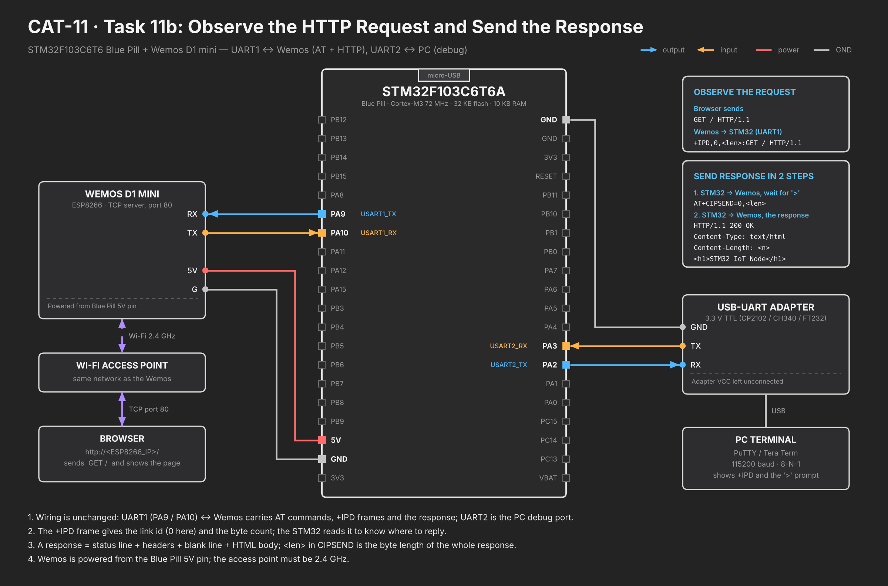

# EXPERIMENT DETAILS
**EXP:** CONTINUOUS ASSESSMENT 11
**DATE:** 12/10/2026
**NAME OF EXP:** HTTP Server - STM32-Wemos Wi-Fi Modem Using AT Commands
**HARDWARE SETUP / PLATFORM:** STM32CubeMX + Keil MDK + STM32F410RBT6 custom development board + Wemos D1 mini (ESP8266)

---

## TASK11B Observe HTTP Request and Send HTTP Response
### 1. Circuit Diagram
- STM32 development board: custom board described by the supplied CAT10C.ioc configuration.
- MCU: STM32F410RBT6, LQFP64 package.
- PA9 (USART1_TX) -> Wemos D1 mini RXD0 / GPIO3.
- PA10 (USART1_RX) <- Wemos D1 mini TXD0 / GPIO1.
- PC6 (USART6_TX) -> USB-UART adapter RX for debug output (assumed, optional).
- PC7 (USART6_RX) is configured by the IOC but is not used by this firmware; no wire is required.
- STM32 GND and Wemos GND must be connected together.
- Wemos 5V pin is powered from a regulated 5V supply (assumed); UART signals are 3.3V logic.
- The STM32 board is powered separately according to its board requirements (assumed).

### 2. Core Logic / Pseudocode / Code Base
**Working Principle:** The STM32 reads incoming ESP8266 UART data and looks for an +IPD frame. It extracts the TCP link ID, builds a static HTTP/1.1 response with the required Content-Length, waits for the ESP8266 CIPSEND prompt, transmits the response, and closes the client connection.

**Pseudocode:**
1. Initialize HAL, clock, GPIO and UART peripherals.
2. Send AT, enable multiple connections, start the TCP server on port 80, and query the ESP8266 IP address.
3. Continuously collect UART bytes from the ESP8266 until the input becomes quiet.
4. Search the received data for +IPD and extract the connection ID.
5. Build the HTML body and HTTP status line/headers; calculate the body and response lengths.
6. Send AT+CIPSEND=<link_id>,<response_length> and wait for the '>' prompt.
7. Transmit the HTTP response bytes, read the modem result and close the TCP connection.

**Code Base:** `HAL_Init`, `SystemClock_Config`, `MX_GPIO_Init`, `MX_USART1_UART_Init`, `MX_USART2_UART_Init`, and `MX_USART6_UART_Init` initialize the STM32F410. USART1 carries ESP8266 AT commands and modem data at 115200 baud, 8 data bits, no parity and 1 stop bit. USART6 provides debug text through PC6 at 115200 baud; PC7 is configured but unused. The application uses `HAL_UART_Transmit`, `HAL_UART_Receive`, `HAL_GetTick`, `memset`, `snprintf`, `strlen`, `strstr`, and `atoi`.
### 3. Inference
This task demonstrates how an HTTP GET request is delivered to the STM32 inside an ESP8266 +IPD notification. The STM32 constructs a valid static HTTP response and sends it back through the ESP8266 TCP connection.

**Assumptions and items to confirm:**
- The supplied `CAT10C.ioc` is used as the base configuration. It specifies STM32F410RBT6, USART1 on PA9/PA10, USART2 on PA2/PA3, and USART6 on PC6/PC7.
- USART1 is connected to the Wemos UART and USART6 is used for a serial debug terminal, following the supplied CAT10 HTTP-server code pattern (assumed).
- The ESP8266 is already connected to a Wi-Fi access point before `AT+CIPSERVER=1,80` is issued (assumed). This document does not provide Wi-Fi credentials.
- The Wemos 5V supply arrangement and optional USB-UART debug adapter are assumed; verify the actual board wiring and common ground before powering.
- [FILL: Wi-Fi SSID and password, if the ESP8266 has not already joined the network.]
- [FILL: ESP8266 IP address shown by `AT+CIFSR`, for browser and Node-RED URL configuration.]
- The IOC identifies a custom STM32F410 board, not a Blue Pill STM32F103 board. The supplied Blue Pill picture is therefore not used as the MCU board drawing.
- Firmware has not been compiled in this environment because the STM32CubeF4 HAL project headers and ARM toolchain are not available here.
