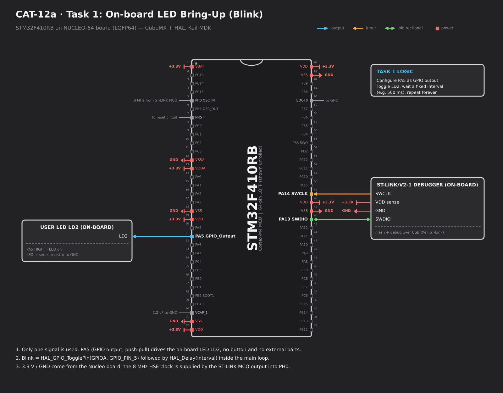

# EXPERIMENT DETAILS
**EXP:** CONTINUOUS ASSESSMENT 12
**DATE:** 14/10/2026
**NAME OF EXP:** STM32F410RB GPIO and User Input Programming
**HARDWARE SETUP / PLATFORM:** STM32CubeMX + Keil MDK + STM32F410RBT6 (custom board configuration from F410trial.ioc)
---
## TASK 12A On-board LED Bring-Up
### 1. Circuit Diagram
- Development platform: custom STM32F410RB configuration based on the supplied F410trial.ioc.
- MCU: STM32F410RBT6, LQFP64.
- PA5: GPIO push-pull output connected to the LED (physical LED connection assumed; series resistor value not specified).

### 2. Core Logic / Pseudocode / Code Base
**Working Principle:** The application configures PA5 as a push-pull output. It toggles the output and waits 500 ms on every loop, producing a regular LED blink.
**Pseudocode:**
1. HAL_Init initializes the HAL and SysTick.
2. SystemClock_Config configures the HSE/PLL clock.
3. MX_GPIO_Init enables GPIOA and configures PA5 as output low.
4. The main loop toggles PA5.
5. HAL_Delay waits 500 ms before the next toggle.
**Code Base:** HAL_Init, SystemClock_Config, MX_GPIO_Init, HAL_GPIO_TogglePin, HAL_Delay; GPIOA pin 5.
### 3. Inference
A LED connected to PA5 changes state every 500 ms, giving approximately a one-second full ON/OFF cycle.
