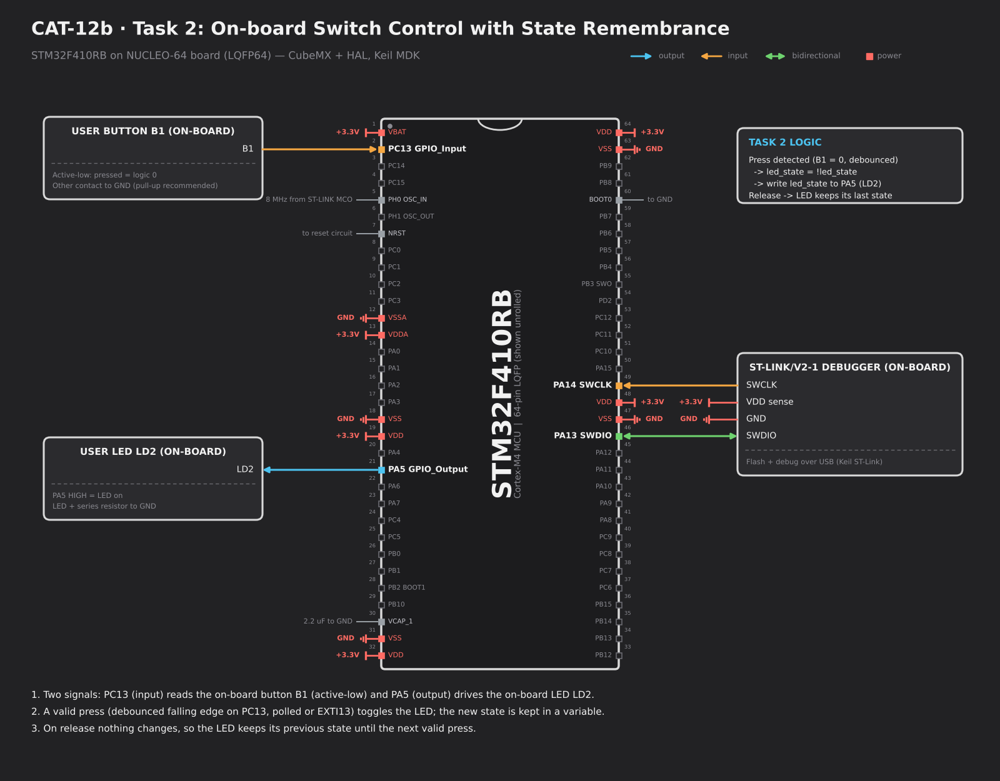

# EXPERIMENT DETAILS
**EXP:** CONTINUOUS ASSESSMENT 12
**DATE:** 14/10/2026
**NAME OF EXP:** STM32F410RB GPIO and User Input Programming
**HARDWARE SETUP / PLATFORM:** STM32CubeMX + Keil MDK + STM32F410RBT6 (custom board configuration from F410trial.ioc)
---
## TASK 12B On-board Switch Control with State Remembrance
### 1. Circuit Diagram
- Development platform: custom STM32F410RB configuration based on the supplied F410trial.ioc.
- MCU: STM32F410RBT6, LQFP64.
- PC13: GPIO input connected to an active-low push button. External 10 kohm pull-up to 3.3V is assumed because the IOC selects GPIO_NOPULL.
- PA5: GPIO push-pull output connected to the LED (physical LED connection assumed; series resistor value not specified).

### 2. Core Logic / Pseudocode / Code Base
**Working Principle:** The application reads the active-low button input on PC13. After a 20 ms debounce delay, a confirmed press toggles the PA5 LED output once, then the code waits for release before accepting another press. The output state remains unchanged after release.
**Pseudocode:**
1. HAL_Init initializes the HAL and SysTick.
2. SystemClock_Config configures the HSE/PLL clock.
3. MX_GPIO_Init configures PC13 as input and PA5 as push-pull output.
4. The loop checks PC13 for a low level.
5. HAL_Delay applies a 20 ms debounce interval and the input is checked again.
6. A confirmed press toggles PA5 once.
7. The loop waits until PC13 returns high, then applies another 20 ms delay.
**Code Base:** HAL_Init, SystemClock_Config, MX_GPIO_Init, HAL_GPIO_ReadPin, HAL_GPIO_TogglePin, HAL_Delay; BUTTON_DEBOUNCE_MS; GPIOC pin 13 and GPIOA pin 5.
### 3. Inference
Each valid button press toggles the LED once. Releasing the button does not change the LED state.
