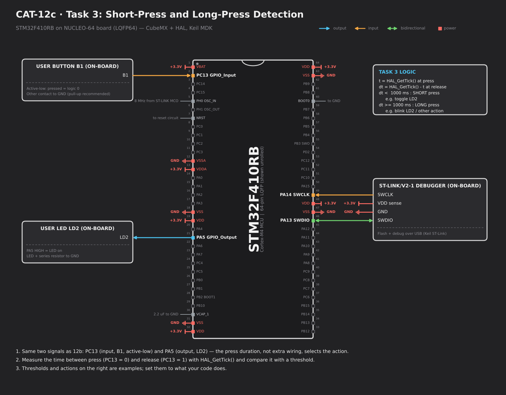

# EXPERIMENT DETAILS
**EXP:** CONTINUOUS ASSESSMENT 12
**DATE:** 14/10/2026
**NAME OF EXP:** STM32F410RB GPIO and User Input Programming
**HARDWARE SETUP / PLATFORM:** STM32CubeMX + Keil MDK + STM32F410RBT6 (custom board configuration from F410trial.ioc)
---
## TASK 12C Short-Press and Long-Press Detection
### 1. Circuit Diagram
- Development platform: custom STM32F410RB configuration based on the supplied F410trial.ioc.
- MCU: STM32F410RBT6, LQFP64.
- PC13: GPIO input connected to an active-low push button. External 10 kohm pull-up to 3.3V is assumed because the IOC selects GPIO_NOPULL.
- PA5: GPIO push-pull output connected to the LED (physical LED connection assumed; series resistor value not specified).

### 2. Core Logic / Pseudocode / Code Base
**Working Principle:** The provided source records a tick value when PC13 is detected low, waits for the input to return high in checkpress(), and compares the elapsed time with 1000 ms. It toggles PA5 for a duration at or below the threshold; otherwise it calls longpress(), whose actual behaviour is described below.
**Pseudocode:**
1. HAL_Init initializes the HAL and SysTick.
2. SystemClock_Config configures the HSE/PLL clock.
3. MX_GPIO_Init configures PC13 as input and PA5 as output.
4. The loop detects PC13 LOW and stores the initial HAL_GetTick value.
5. checkpress waits while PC13 remains LOW.
6. The final tick is read and elapsed time is compared with 1000 ms.
7. For an elapsed time at or below 1000 ms, PA5 is toggled; otherwise longpress is called.
8. longpress toggles PA5 at approximately 500 ms intervals while PC13 reads HIGH, and returns if PC13 reads LOW.
**Code Base:** HAL_Init, SystemClock_Config, MX_GPIO_Init, HAL_GPIO_ReadPin, HAL_GPIO_TogglePin, HAL_GetTick; local functions checkpress and longpress; GPIOC pin 13 and GPIOA pin 5.
### 3. Inference
The source attempts to classify button duration using a 1000 ms threshold. However, the long-press branch waits for a subsequent input state and toggles PA5 while PC13 is HIGH, rather than implementing a clear long-press action during the original hold.
