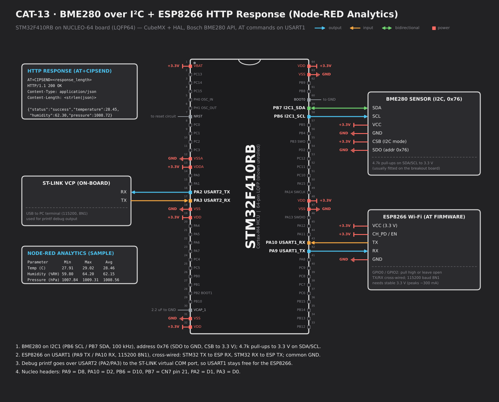

# EXPERIMENT DETAILS
**EXP:** CONTINUOUS ASSESSMENT 13
**DATE:** 23/10/2026
**NAME OF EXP:** BME280 Sensor Interfacing Using I2C and Bosch Sensor API
**HARDWARE SETUP / PLATFORM:** CubeMX + Keil MDK + STM32 Nucleo Development Board with STM32F410RBT6 + BME280 sensor + UART interface
---
## TASK 13A BME280 Sensor Interfacing Using I2C and Bosch Sensor API
### 1. Circuit Diagram
- Development board: STM32 Nucleo Development Board (exact board variant is not specified in the supplied problem statement).
- MCU: STM32F410RBT6, as specified by CAT12v2.ioc.
- PB6: I2C1_SCL connected to the BME280 SCL pin.
- PB7: I2C1_SDA connected to the BME280 SDA pin.
- PA9: USART1_TX connected to the UART receive input of the intended ESP8266 or serial interface.
- PA10: USART1_RX connected to the UART transmit output of the intended ESP8266 or serial interface.
- BME280: 3.3V and GND power connections; the code selects I2C address 0x76 (primary address, SDO low).
- ESP8266 UART connection is shown as an intended/assumed physical link. The supplied code does not configure ESP8266 AT commands or HTTP transmission.
- I2C pull-up resistors are not specified; they may already be present on the BME280 breakout board (assumed).

### 2. Core Logic / Pseudocode / Code Base
**Working Principle:** The STM32 initializes HAL, the system clock, I2C1 and USART1. It connects the Bosch BME280 Sensor API to STM32 HAL I2C read, write and delay functions, verifies the sensor chip ID, initializes calibration data and configures temperature, pressure and humidity oversampling with normal operating mode. The application reads compensated sensor values once per second, converts pressure from Pa to hPa, and prints temperature, pressure and relative humidity through USART1.

**Pseudocode:**
1. Call `HAL_Init()` and configure the system clock.
2. Initialize GPIO, I2C1 and USART1.
3. Set the Bosch API interface pointer, I2C interface type, read callback, write callback and delay callback.
4. Read the BME280 chip ID from register 0xD0 and call `Error_Handler()` if the read fails or the ID is incorrect.
5. Call `bme280_init()` to reset the sensor and load calibration data; handle initialization failure.
6. Set temperature, pressure and humidity oversampling to 1X, disable the filter and select a 1000 ms standby time.
7. Apply the sensor settings and select normal continuous measurement mode; handle API errors.
8. Calculate the measurement delay and wait for the first conversion.
9. Repeatedly call `bme280_get_sensor_data()` for temperature, pressure and humidity.
10. On a successful read, store temperature in degrees Celsius, convert pressure from Pa to hPa and store relative humidity; print the values through USART1. On failure, print the read error.
11. Wait 1000 ms and repeat the measurement loop.

**Code Base:** The code uses STM32 HAL functions `HAL_Init()`, `HAL_I2C_Mem_Read()`, `HAL_I2C_Mem_Write()`, `HAL_UART_Transmit()` and `HAL_Delay()`. It initializes `I2C1` through `hi2c1` and `USART1` through `huart1`. Bosch API functions used include `bme280_get_regs()`, `bme280_init()`, `bme280_set_sensor_settings()`, `bme280_set_sensor_mode()`, `bme280_cal_meas_delay()` and `bme280_get_sensor_data()`. Application variables include `dev`, `settings`, `comp_data`, `rslt`, `chip_id`, `meas_delay_us`, `temperature`, `pressure` and `humidity`. The `_write()` function redirects `printf()` output to USART1.

### 3. Inference
The experiment demonstrates I2C communication between the STM32F410RB and the BME280 sensor, sensor identification, Bosch API initialization and compensated temperature, pressure and humidity measurement. The measured values are printed periodically through USART1. The supplied main.c does not implement the ESP8266 AT-command sequence, dynamic JSON payload, HTTP response or Node-RED analytics described in the later pages of the problem statement.

**Implementation notes:**
- The supplied `main(9).c` is used unchanged.
- The supplied `CAT12v2.ioc` configures STM32F410RBT6, I2C1 on PB6/PB7 and USART1 on PA9/PA10. These match the peripherals and pins used by the supplied code.
- The Bosch driver source files `bme280.c`, `bme280.h` and `bme280_defs.h` are required by the problem statement but were not among the supplied files. Add the matching Bosch Sensor API files to the project before building.
- [FILL: Confirm the exact Nucleo board model.]
- [FILL: Confirm whether the BME280 breakout has onboard I2C pull-up resistors.]
- [FILL: Confirm whether USART1 is connected to the ESP8266 or a USB-to-UART terminal.]
