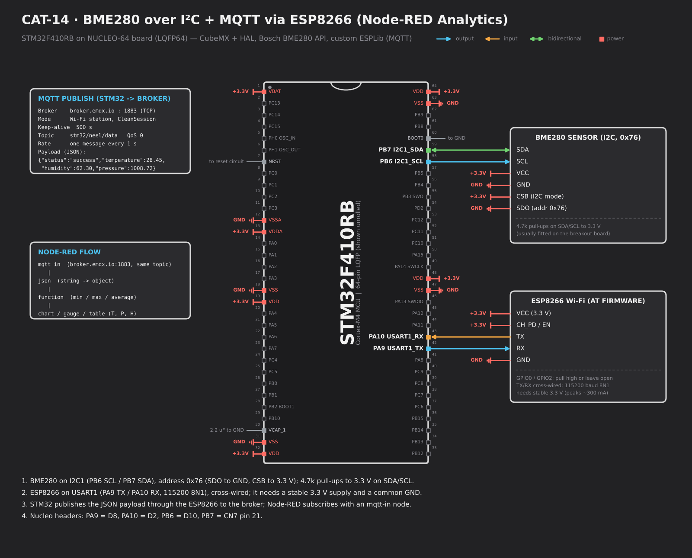

# EXPERIMENT DETAILS
**EXP:** CONTINUOUS ASSESSMENT 14
**DATE:** 27/10/2026
**NAME OF EXP:** Sensor Interfacing (BME280) - (MQTT) - Node Analytics
**HARDWARE SETUP / PLATFORM:** STM32CubeMX + Keil MDK + STM32 Nucleo Development Board with STM32F410RBT6 + ESP8266 Wi-Fi module
---
## TASK 14A - BME280 Sensor Interfacing Using I2C and MQTT
### 1. Circuit Diagram
- Development board: STM32 Nucleo development board.
- MCU: STM32F410RBT6.
- PA9 (USART1_TX): connected to ESP8266 RX.
- PA10 (USART1_RX): connected to ESP8266 TX.
- ESP8266 supply: 3.3V (assumed; verify the module/adapter power requirements).
- Common ground between STM32 and ESP8266 (assumed).
- MQTT broker: broker.emqx.io, TCP port 1883.
- BME280: not connected in the supplied main.c and not configured in the supplied IOC.

### 2. Core Logic / Pseudocode / Code Base
**Working Principle:** The supplied program initializes the ESP8266 through USART1, connects it to the configured Wi-Fi network, opens a TCP connection to the public MQTT broker, and initializes an MQTT client with a clean session. It then publishes the fixed text payload "Hi from Neel & Maithreyan" to the topic "stm32/neel/data" using QoS 0 once every second. The supplied code does not read a BME280 sensor or construct a temperature, pressure, and humidity JSON payload.

**Pseudocode:**
1. Call `HAL_Init()` and configure the system clock.
2. Initialize GPIO and USART1.
3. Initialize the ESP8266 in station mode using `huart1`.
4. Connect to the configured Wi-Fi network.
5. Open a TCP connection to `broker.emqx.io` on port `1883`.
6. Configure MQTT keep-alive, clean-session flag, and client ID.
7. Connect the MQTT client to the broker.
8. Repeat forever: publish the fixed message to `stm32/neel/data` with QoS 0, then wait 1000 ms.

**Code Base:** The supplied `main.c` uses `HAL_Init()`, `SystemClock_Config()`, `MX_GPIO_Init()`, `MX_USART1_UART_Init()`, `HAL_Delay()`, `UART_HandleTypeDef huart1`, `ESP8266_Init()`, `ESP8266_wifiConnect()`, `ESP8266_portConnect()`, `MQTT_connectBroker()`, and `MQTT_publishTopic()`. It depends on the external custom library `ESPLib.h` and its implementation `ESPLib.c`.

### 3. Inference
The supplied program demonstrates UART-based control of an ESP8266 module and periodic MQTT publishing from the STM32F410RBT6. The MQTT message can be received by a subscriber on the configured topic. The BME280 sensing, I2C communication, Bosch compensation, and JSON telemetry required by the experiment statement are not implemented in the supplied code and must be added before the task represents the complete sensor-analytics experiment.

### 4. Implementation Notes
- The IOC configures USART1 on PA9 and PA10, matching the UART handle and pins used by the supplied `main.c`.
- The IOC does not configure I2C. No BME280 I2C pins or sensor wiring are shown because the supplied code does not use them.
- The PDF describes BME280 I2C acquisition and MQTT JSON telemetry, but the supplied `main.c` is MQTT publisher-only. This is a source/problem-statement mismatch; the original code has been preserved unchanged.
- The PDF's example JSON contains `status`, `temperature`, `humidity`, and `pressure`. Those fields are not produced by the supplied program.
- The supplied `main.c` comment says USART2, but the actual handle is `huart1` and the IOC configures USART1. The code's handle and IOC agree; the comment is inaccurate.
- The exact ESP8266 module/adapter model and its power arrangement are not specified. The 3.3V supply and common-ground connections are marked assumed.
- The Wi-Fi credentials are hard-coded in the supplied source file. Replace them with the intended network credentials before running the program.
