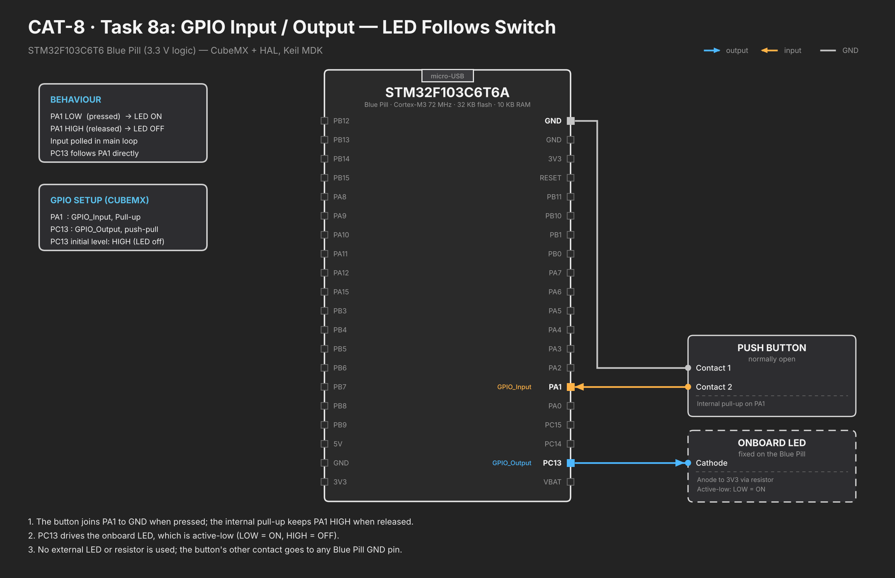

# EXPERIMENT DETAILS

**EXP:** CONTINUOUS ASSESSMENT 8

**DATE:** 18/09/2026

**NAME OF EXP:** STM32 GPIO Bring-Up and Switch-Controlled LED

**HARDWARE SETUP / PLATFORM:** CubeMX + Keil MDK + STM32 Blue Pill development board with STM32F103C6T6A

---
## TASK 8A GPIO Input/Output

### 1. Circuit Diagram

- Development board: STM32 Blue Pill.
- Microcontroller: STM32F103C6T6A.
- PA1: push-button input, configured with internal pull-up; connect the normally-open button between PA1 and GND (assumed).
- PC13: onboard LED output; active-low, so LOW turns the LED ON and HIGH turns it OFF.
- No external LED or series resistor is used; the LED is the board's onboard indicator.

### 2. Core Logic / Pseudocode / Code Base

**Working Principle:** The firmware continuously reads PA1. Since the input uses an internal pull-up, a pressed button reads LOW and a released button reads HIGH. The code drives PC13 LOW while pressed and HIGH while released, so the onboard active-low LED follows the switch state.

**Pseudocode:**

1. Initialize HAL.
2. Configure the system clock using the HSE and PLL settings.
3. Initialize GPIOC and GPIOA; configure PC13 as push-pull output and PA1 as input with pull-up.
4. Set PC13 HIGH initially to keep the active-low LED OFF.
5. Repeatedly read PA1.
6. If PA1 is LOW, write LOW to PC13; otherwise write HIGH to PC13.
7. Repeat without a blocking delay.

**Code Base:** `HAL_Init()`, `SystemClock_Config()`, `MX_GPIO_Init()`, `HAL_GPIO_ReadPin()`, and `HAL_GPIO_WritePin()` are used. GPIOA pin 1 is the button input and GPIOC pin 13 is the onboard LED output.

### 3. Inference

The experiment demonstrates digital GPIO input and output. The onboard LED remains ON while the active-low button is pressed and turns OFF when the button is released.
