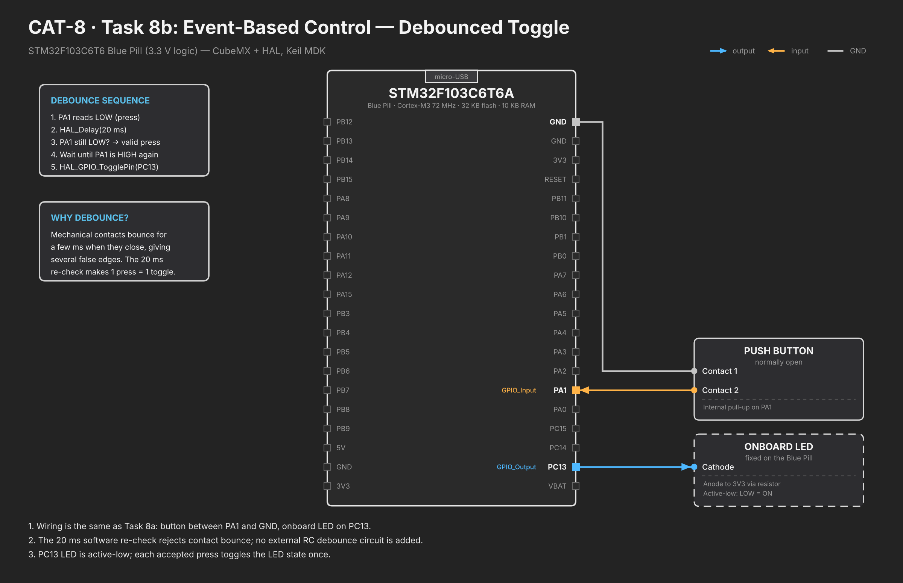

# EXPERIMENT DETAILS

**EXP:** CONTINUOUS ASSESSMENT 8

**DATE:** 18/09/2026

**NAME OF EXP:** STM32 GPIO Bring-Up and Switch-Controlled LED

**HARDWARE SETUP / PLATFORM:** CubeMX + Keil MDK + STM32 Blue Pill development board with STM32F103C6T6A

---
## TASK 8B Event-Based Control

### 1. Circuit Diagram

- Development board: STM32 Blue Pill.
- Microcontroller: STM32F103C6T6A.
- PA1: push-button input with internal pull-up; the code assumes an active-low button connected between PA1 and GND.
- PC13: onboard LED output; active-low.
- No external LED or resistor is used.

### 2. Core Logic / Pseudocode / Code Base

**Working Principle:** The main loop detects a LOW level on PA1, waits 20 ms, and checks the input again to reject a short transient. When the input remains LOW, `checkpress()` waits until the button is released and then toggles PC13 once. The code therefore waits for release before accepting the next press.

**Pseudocode:**

1. Initialize HAL, configure the clock, and initialize GPIO.
2. Enter the infinite loop and read PA1.
3. If PA1 is LOW, wait 20 ms.
4. Read PA1 again; continue only if it is still LOW.
5. Call `checkpress()`; it waits while PA1 remains LOW.
6. After release, toggle PC13 once using `HAL_GPIO_TogglePin()`.
7. Return to the main loop.

**Code Base:** The code uses `HAL_Init()`, `SystemClock_Config()`, `MX_GPIO_Init()`, `HAL_GPIO_ReadPin()`, `HAL_Delay()`, and `HAL_GPIO_TogglePin()`. The input is PA1 and the output is PC13. The local `checkpress()` function is defined inside `main()`.

### 3. Inference

The intended response is one LED state change for each debounced press-and-release action. The onboard LED is active-low. The provided source defines a nested function inside `main()`, which is a GCC extension and is not standard C; check compiler support in the selected Keil toolchain.
