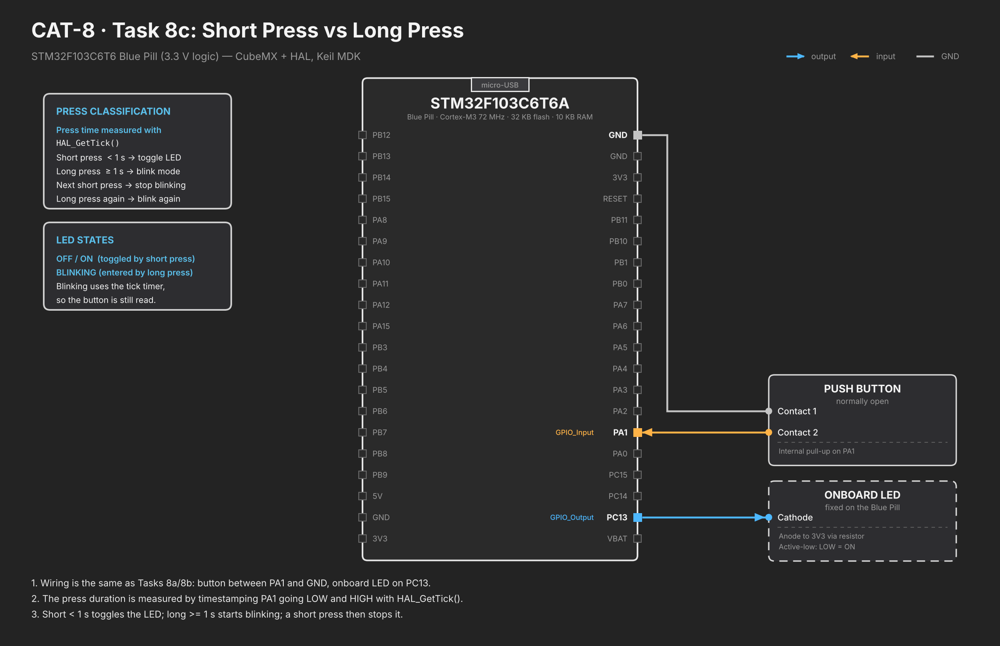

# EXPERIMENT DETAILS

**EXP:** CONTINUOUS ASSESSMENT 8

**DATE:** 18/09/2026

**NAME OF EXP:** STM32 GPIO Bring-Up and Switch-Controlled LED

**HARDWARE SETUP / PLATFORM:** CubeMX + Keil MDK + STM32 Blue Pill development board with STM32F103C6T6A

---
## TASK 8C Short Press vs Long Press

### 1. Circuit Diagram

- Development board: STM32 Blue Pill.
- Microcontroller: STM32F103C6T6A.
- PA1: push-button input with internal pull-up; active-low button wiring to GND is assumed.
- PC13: onboard LED output; active-low.
- No external LED or resistor is used.

### 2. Core Logic / Pseudocode / Code Base

**Working Principle:** The supplied program records a tick value when PA1 is detected LOW, performs a 20 ms debounce, and waits for the button to be released in `checkpress()`. It calculates elapsed time with `HAL_GetTick()` and compares it with 980 ms. The supplied `longpress()` function contains additional blocking loops, LED toggles with 100 ms delays, and a recursive call; these are described as written and do not implement the required non-blocking state machine reliably.

**Pseudocode:**

1. Initialize HAL, configure the clock, and initialize GPIO.
2. Initialize `bstart`, `btime`, and `spcount`.
3. In the main loop, detect PA1 LOW and record `bstart` with `HAL_GetTick()`.
4. Wait 20 ms and confirm PA1 is still LOW.
5. Call `checkpress()`, which waits until PA1 becomes HIGH.
6. Calculate `btime` as the current tick minus `bstart`.
7. If `btime` is below 980 ms, call `shortpress()` to toggle PC13; otherwise call `longpress()`.
8. In `longpress()`, the supplied code toggles PC13 with 100 ms delays while its loops run, and may call itself recursively.

**Code Base:** The source uses `HAL_GetTick()`, `HAL_GPIO_ReadPin()`, `HAL_GPIO_TogglePin()`, and `HAL_Delay()`. It uses `bstart`, `btime`, and `spcount`, and GPIO pins PA1 and PC13. `checkpress()`, `shortpress()`, and `longpress()` are nested inside `main()` in the supplied source.

### 3. Inference

The task specification requires short presses below 1 second to toggle the LED and long presses of 1 second or more to control a continuous blinking mode, with the next short press stopping blinking. The supplied code does not meet the non-blocking requirement: it contains `HAL_Delay()` in long-press handling, nested function definitions, and recursive control flow. It should be treated as the submitted source, not as a verified implementation of the specified state machine.
