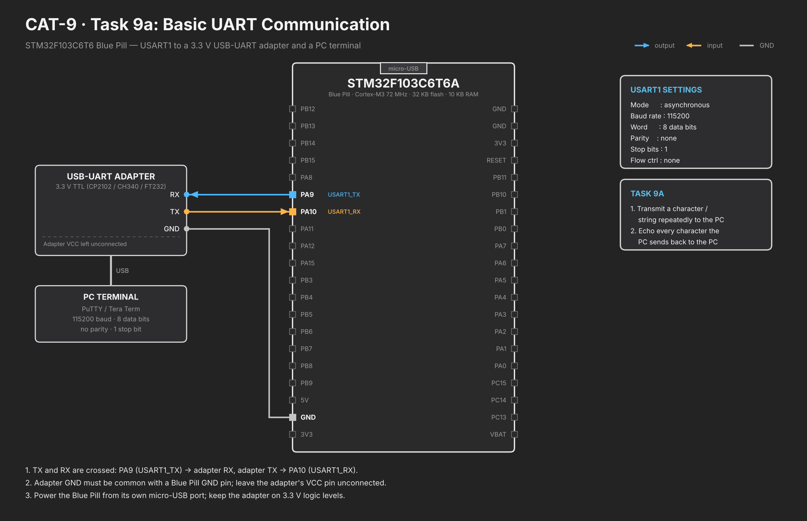

# EXPERIMENT DETAILS

**EXP:** CONTINUOUS ASSESSMENT 9

**DATE:** 28/09/2026

**NAME OF EXP:** STM32 UART Command Controlled LED

**HARDWARE SETUP / PLATFORM:** CubeMX + Keil MDK + STM32 Blue Pill STM32F103C6T6A

---

## TASK 9A Basic UART Communication

### 1. Circuit Diagram

The STM32 communicates with a PC terminal through a 3.3 V TTL USB-UART adapter.

- **Development Board:** STM32 Blue Pill
- **Microcontroller IC:** STM32F103C6T6A
- **USART Peripheral:** USART1, asynchronous mode
- **PA9:** USART1_TX, connected to the USB-UART adapter RX pin
- **PA10:** USART1_RX, connected to the USB-UART adapter TX pin
- **GND:** STM32 ground connected to adapter ground (assumed)
- **External Device:** 3.3 V TTL USB-UART adapter connected to a PC terminal (assumed)
- **Serial Configuration:** 115200 baud, 8 data bits, no parity, 1 stop bit

### 2. Core Logic / Pseudocode / Code Base

**Working Principle:**

The program initializes HAL, configures the system clock and initializes USART1. It repeatedly transmits the string `Hello Neel` followed by carriage return and line feed, attempts to receive 12 bytes, and conditionally transmits the received buffer. The receive condition in the supplied code is inverted because `HAL_UART_Receive()` returns `HAL_OK` (zero) when reception succeeds.

**Pseudocode:**

1. Initialize the STM32 HAL library.
2. Configure the system clock.
3. Initialize GPIO and USART1.
4. Store the transmit message `Hello Neel` followed by CR and LF.
5. Create a 12-byte receive buffer.
6. Transmit the message using `HAL_UART_Transmit()`.
7. Attempt to receive 12 bytes using `HAL_UART_Receive()` with a 1000 ms timeout.
8. If the return value is non-zero, transmit the receive buffer using `HAL_UART_Transmit()`.
9. Wait 500 ms and repeat.

**Code Base:**

The program uses `HAL_Init()`, `SystemClock_Config()`, `MX_GPIO_Init()`, `MX_USART1_UART_Init()`, `HAL_UART_Transmit()`, `HAL_UART_Receive()` and `HAL_Delay()`. The UART handle is `huart1`; the transmit array is `data` and the receive array is `rdata`.

### 3. Inference

The experiment demonstrates asynchronous UART transmission and reception between the STM32 and a PC terminal. The supplied code sends a fixed message periodically, but its receive-result condition is reversed and should be corrected before expecting successfully received data to be echoed. The configured PC13 output is not used by this application code.
