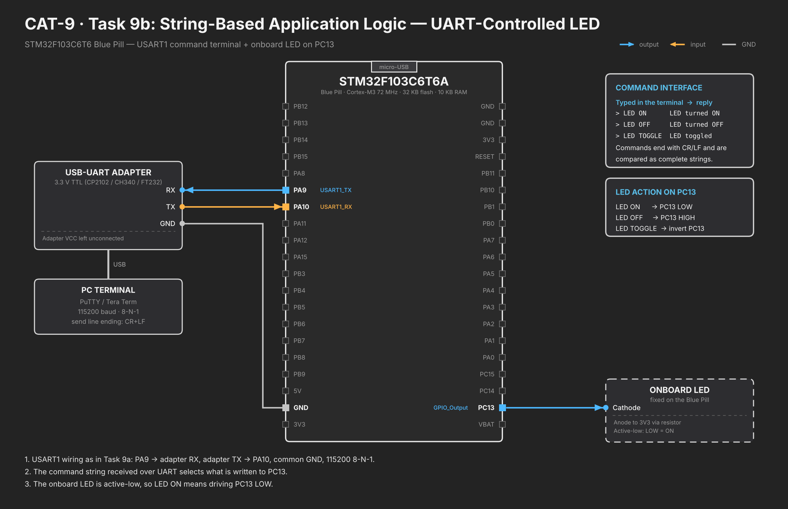

# EXPERIMENT DETAILS

**EXP:** CONTINUOUS ASSESSMENT 9

**DATE:** 28/09/2026

**NAME OF EXP:** STM32 UART Command Controlled LED

**HARDWARE SETUP / PLATFORM:** CubeMX + Keil MDK + STM32 Blue Pill STM32F103C6T6A

---

## TASK 9B String-Based Application Logic

### 1. Circuit Diagram

The STM32 receives serial characters from a PC terminal and transmits each received character back through USART1.

- **Development Board:** STM32 Blue Pill
- **Microcontroller IC:** STM32F103C6T6A
- **USART Peripheral:** USART1, asynchronous mode
- **PA9:** USART1_TX, connected to the USB-UART adapter RX pin
- **PA10:** USART1_RX, connected to the USB-UART adapter TX pin
- **GND:** STM32 ground connected to adapter ground (assumed)
- **External Device:** 3.3 V TTL USB-UART adapter connected to a PC terminal (assumed)
- **Serial Configuration:** 115200 baud, 8 data bits, no parity, 1 stop bit

### 2. Core Logic / Pseudocode / Code Base

**Working Principle:**

The program initializes HAL, configures the system clock and initializes USART1. In its main loop, it waits indefinitely for one byte from the PC terminal, transmits that byte back to the terminal, and increments the buffer index. Although the problem statement requires string-based commands such as `LED ON`, `LED OFF` and `LED TOGGLE`, the supplied code does not parse commands or control the onboard LED.

**Pseudocode:**

1. Initialize the STM32 HAL library.
2. Configure the system clock.
3. Initialize GPIO and USART1.
4. Create a 100-byte receive buffer and set `bcount` to zero.
5. Wait indefinitely to receive one byte into `buffer[bcount]` using `HAL_UART_Receive()`.
6. Transmit the received byte back using `HAL_UART_Transmit()`.
7. Increment `bcount`.
8. Repeat the receive and echo process continuously.

**Code Base:**

The program uses `HAL_Init()`, `SystemClock_Config()`, `MX_GPIO_Init()`, `MX_USART1_UART_Init()`, `HAL_UART_Receive()` and `HAL_UART_Transmit()`. The UART handle is `huart1`; the receive array is `buffer` and the array index is `bcount`.

### 3. Inference

The experiment demonstrates blocking UART character reception and echo transmission. The supplied code does not yet implement the required string command interface or LED ON, OFF and TOGGLE actions. The variable `bcount` increases without a bounds check, so the program can write beyond the 100-byte buffer during continued operation.
